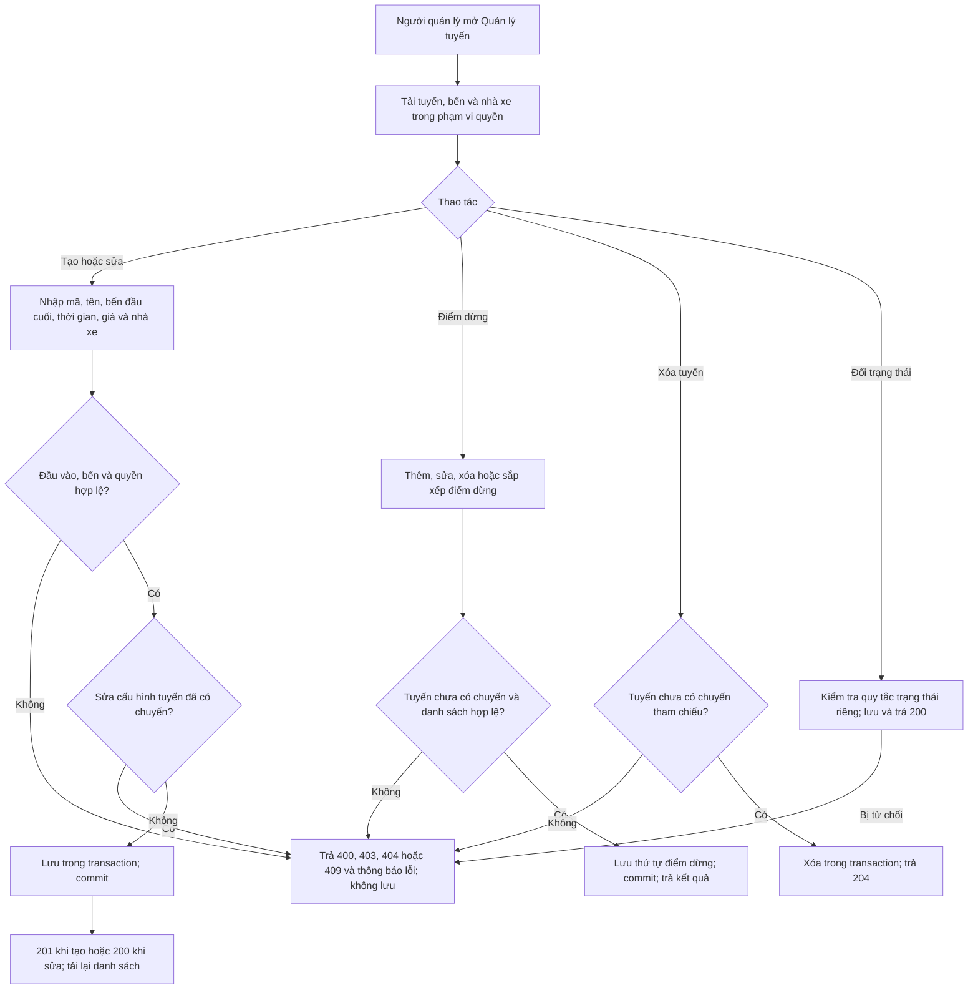
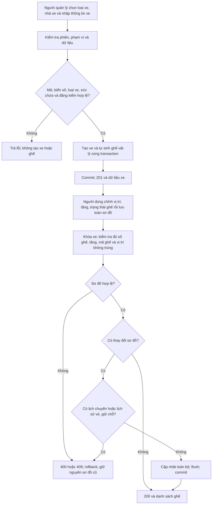
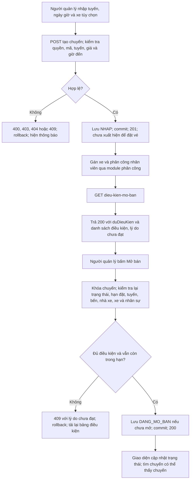
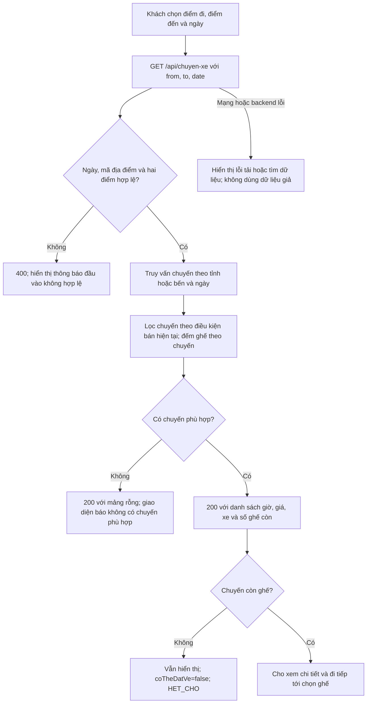
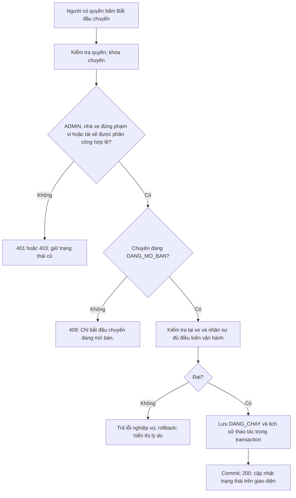
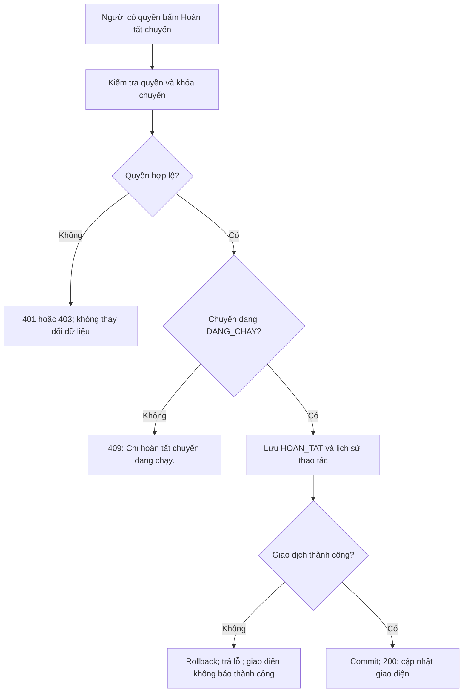
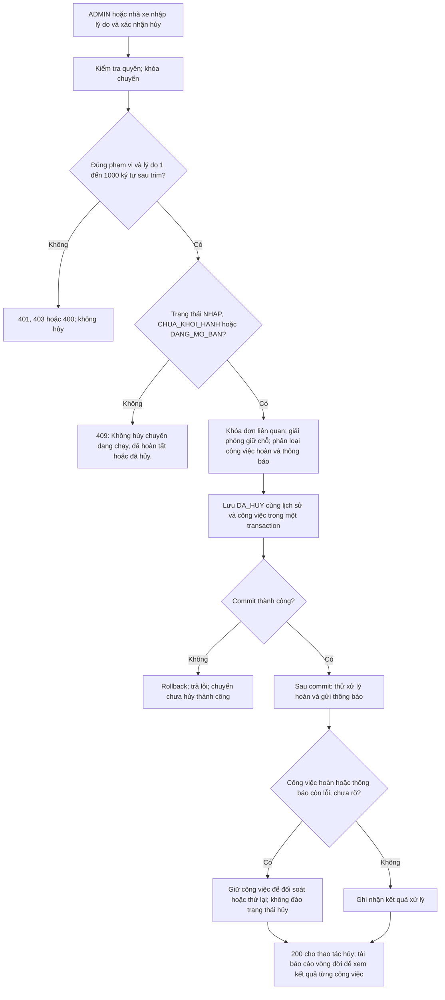

# Luồng demo tuyến, xe và chuyến

Chạy ứng dụng từ thư mục gốc theo [README dự án](../../../README.md).
Phạm vi và danh sách file chính thức nằm trong [README của Hiền](../README.md#source).
Tài liệu này gộp thứ tự mở code, sơ đồ nghiệp vụ và bảng truy vết; kết quả chạy được giữ trong [testing/README.md](../testing/README.md).

## Chuẩn bị

Cần JDK 21, Maven 3.9.9, Node.js 22 và Docker Desktop. Dùng `.env` theo cấu hình dự án,
không commit thông tin bí mật. Tài khoản seed được mô tả ở [database/tai-khoan-mau.md](../../../database/tai-khoan-mau.md).
Dùng database phát triển/thử riêng khi tạo dữ liệu kiểm thử; không reset volume để nâng cấp schema.
Migration và seed: [hướng dẫn database](../../../database/README.md).

```bash
mvn -B -f apps/backend/pom.xml verify
docker compose up -d postgres backend
```

Kiểm tra kết quả từng lệnh trước khi chạy tiếp. Backend phải dùng WAR vừa build;
sau lần build tiếp theo, chạy `docker compose restart backend` và kiểm tra `GET /api/health` trả 200.
Nếu khởi tạo database dừng ở migration hoặc verify thất bại, đọc lỗi và phần giới hạn trong báo cáo kiểm thử;
không coi container có trạng thái chạy là toàn bộ ứng dụng đã sẵn sàng.

Mở terminal khác, từ thư mục gốc:

```bash
npm ci
npm run dev
```

Dùng cùng hostname frontend đã cấu hình trong `FRONTEND_ORIGIN`. Chạy frontend trong thư mục gốc
để sử dụng lockfile và cấu trúc chung; không cần đổi sang các nhánh tính năng T10/T12 cũ.

## Cách đọc frontend sau refactor

| Nhóm | Component cha | Component con | Dữ liệu và hàm chuyển form |
|---|---|---|---|
| Tỉnh, bến, tuyến, điểm dừng | `RouteManagement` | `CityPanel`, `StationPanel`, `RouteForm`, `RouteList`, `RouteStopsPanel` | `routes/lib/route-types.ts` |
| Xe và sơ đồ ghế | `VehicleManagement` | `VehicleTypePanel`, `VehicleForm`, `VehicleList`, `VehicleSeatLayout`, `VehicleField` | `vehicles/lib/vehicle-types.ts` |
| Chuyến và vòng đời | `TripManagement` | `TripForm`, `TripList`, `TripDetails`, `TripSaleConditions`, `TripLifecyclePanel`, `TripPassengerModal` | `trips/lib/trip-types.ts`, `trip-passengers-api.ts` |

Các đường dẫn FE tính từ `frontend/src` trong thư mục thành viên.
Component cha giữ state, dựng payload và gọi API. Component con nhận dữ liệu/callback, hiển thị và chuyển sự kiện về cha.
Không viết lại cookie/CSRF ở từng component: dùng `useAuth().request`; lỗi được đưa qua `errorMessage`.
`try/catch/finally` thể hiện các bước gửi, tải lại dữ liệu, báo kết quả và mở lại thao tác.
Ref `sending` chặn gửi trùng; mã phiên bản thông báo ngăn kết quả cũ hiện lại sau tương tác mới.

Giữ riêng danh mục tỉnh/bến/loại xe và kết quả lọc bảng để việc tìm kiếm không làm mất lựa chọn trong form khác.
Dữ liệu form là bản nháp trên FE; chỉ thông báo đã lưu sau khi API thao tác thành công.
Hàm chuyển form giữ đúng kiểu chuỗi/ngày giờ và chuyển trường rỗng sang `null` theo hợp đồng API.
Giữ tên trường JSON; khai báo ngắn có thể ở một dòng, chỉ tách dòng khi cần đọc các thuộc tính/bước xử lý dài.

<a id="so-do-nghiep-vu"></a>

### Quy ước đọc sơ đồ

Các luồng ghi dữ liệu kiểm tra đăng nhập, quyền và CSRF tại tầng xác thực chung,
sau đó kiểm tra phạm vi tài nguyên ở Service. Lỗi xác thực/quyền trả 401/403;
CSRF sai hoặc thiếu bị từ chối theo bộ lọc chung. Không coi việc ẩn nút ở frontend là phân quyền.
Lỗi nghiệp vụ được trả qua `ApiErrors` với thông báo để giao diện hiển thị bằng `errorMessage`.
Các thông báo trong dấu ngoặc kép dưới đây được lấy từ code, là ví dụ đại diện,
không phải danh sách đầy đủ mọi lỗi. Lỗi trong transaction làm rollback; lỗi sau commit được xử lý theo từng luồng.

## 1. Quản lý tuyến và điểm dừng

### Thứ tự mở file và demo

`RouteManagement` → `CityPanel`/`StationPanel`/`RouteForm`/`RouteStopsPanel` →
`RouteTripController` → `RouteTripService` → JPA và `Entities.java`.
Mở `route-types.ts` để xem form trống, các hàm `routeToForm`/`stopToForm` và nhãn trạng thái.
Demo: tạo tỉnh/bến → tạo tuyến → thêm hai điểm dừng → sửa/đổi thứ tự → thử xóa tuyến đã có chuyến.

### Luồng xử lý

Frontend: `RouteManagement.tsx`; Controller: `RouteTripController.handleRoutes`;
Service: `RouteTripService`. Endpoint gốc `/api/tuyen-xe`.



Ví dụ lỗi: 400 “Trạm khởi hành và trạm đến phải khác nhau”; 409
“Bến khởi hành và bến đến phải đang hoạt động để cấu hình tuyến”.
Đổi trạng thái là thao tác riêng; không suy ra tuyến đã có chuyến thì mọi thao tác đều bị cấm.
Kiểm thử: `RouteTripServiceTest.stationAndRouteValidationAndDeleteProtection`,
`routeAndStopsCannotBeChangedAfterTripsExistButStatusCanChange`,
`invalidStopOperationsDoNotChangeExistingOrder`.

<a id="section-1"></a>

## 2. Tạo xe và sơ đồ ghế

### Thứ tự mở file và demo

`VehicleManagement` → `VehicleTypePanel`/`VehicleForm` → `VehicleController` →
`VehicleService.saveType`/`saveVehicle` → `LoaiXeRepository`/`XeRepository`.
Tiếp theo mở `VehicleSeatLayout` → `handleSaveSeatLayout` trong component cha → `VehicleService.saveLayout`.
Demo: tạo loại xe → tạo xe đủ đăng kiểm → sửa sơ đồ hai tầng → lưu, F5 và đọc lại → thử vị trí trùng.

### Luồng xử lý

Frontend: `VehicleManagement.tsx`; Controller: `VehicleController`;
Service: `VehicleService`. Tạo xe dùng `POST /api/xe`, lưu sơ đồ dùng
`PUT /api/xe/{maXe}/so-do-ghe`.



Ví dụ lỗi: 409 “Biển số đã tồn tại.”; 400 “Sức chứa phải khớp với loại xe.”;
400 “Tầng ghế không hợp lệ.”; 409 “Xe đang có lịch chuyến; không sửa sơ đồ ghế.”.
Ghế vật lý hoạt động/bảo trì khác với tình trạng trống/giữ/đã bán của một chuyến.
Kiểm thử: `VehicleTask10Test.typeAndVehicleValidationUniquePlatesAndFilters`,
`layoutRejectsWrongCountsDuplicatesForeignIdsAndInvalidFloorsWithoutPartialSave`;
`PostgresTask10Test.concurrentSamePlateAcrossTypesCreatesOnlyOneCompleteVehicle`.

<a id="section-2"></a>

## 3. Tạo chuyến nháp và mở bán

### Thứ tự mở file và demo

`TripManagement` → `TripForm`/`TripList`/`TripDetails`/`TripSaleConditions` →
`TripController` → `TripService.create`/`eligibility`/`open` → `TripSaleRules` → `ChuyenXeRepository`.
Demo: lưu nháp thiếu xe/nhân sự → xem lý do chưa đạt → chuẩn bị xe và phân công T11 → kiểm tra lại → mở bán.

### Luồng xử lý

Frontend: `TripManagement.tsx`; Controller: `TripController`;
Service: `TripService`, `TripSaleRules`, `VehicleRules`, `AssignmentRules`.
Endpoint gốc `/api/quan-ly/chuyen-xe`.



Tạo nháp cho phép thiếu xe và nhân sự; mở bán thì bắt buộc đủ điều kiện.
GET điều kiện không đạt vẫn có thể trả 200 với `duDieuKien=false`; POST mở bán thất bại trả 409.
Ví dụ lỗi: “Mã chuyến đã tồn tại.”; “Ngày giờ đến phải sau khởi hành.”;
“Chuyến chưa được gán xe.”; “Đã đến thời điểm ngừng nhận đặt vé trong khi kiểm tra điều kiện.”.
Mở bán lại trong hạn và đủ điều kiện không tạo chuyến mới. Hai chuyến xung đột lịch phải kiểm tra bằng khóa database.
Kiểm thử: `TripServiceTest.draftCanLackVehicleAndCrewButCannotBeSearchedOrSold`,
`actualT11AssignmentFlowAndIdempotentOpening`, `cutoffReachedDuringValidationStillRollsBackOpening`;
`PostgresTripTest.conflictingSimultaneousPublishSerializesUnderDatabaseLocks`.

<a id="section-3"></a>

## 4. Tìm chuyến

### Thứ tự mở file và demo

Frontend Thế An: `SearchForm` → `SearchResultsPage` → `booking/lib/api.ts`.
Backend Hiền: `RouteTripController.handleTrips` → `RouteTripService.searchChuyenXe` →
`ChuyenXeRepository.findForSearch` → `TripSaleRules.ensureSellable` → `searchView`.
Demo: tìm chuyến theo tỉnh/ngày → xem ghế còn → thử cùng điểm đi/đến, ngày không có chuyến và lỗi API.

### Luồng xử lý

Frontend thuộc Nguyễn Thế An: `SearchForm.tsx`, `SearchResultsPage.tsx`, `booking/lib/api.ts`.
Backend của Hiền: `RouteTripController.handleTrips` → `RouteTripService.searchChuyenXe`
→ `ChuyenXeRepository.findForSearch` → `TripSaleRules.ensureSellable` → `searchView`.



Ví dụ lỗi: “Ngày đi là bắt buộc”; “Tỉnh đi và tỉnh đến phải khác nhau.”.
Chuyến không còn đủ điều kiện bán bị bỏ khỏi kết quả; không trả lỗi toàn bộ chỉ vì một chuyến không bán được.
Kết quả rỗng là thành công HTTP, khác lỗi API. Chọn ghế ở frontend chưa giữ ghế trong database.
Kiểm thử: `RouteTripServiceTest.emptySearchWrongDirectionDateAndDepartureOrdering`,
`searchAcceptsCityStationAndLegacyCodesWithoutChangingSaleRules`,
`publicDetailAndAvailabilityUseCurrentTripSpecificSeats`.

## 5. Bắt đầu chuyến

### Thứ tự mở file và demo

`TripDetails` → `TripManagement.handleStartTrip` → `TripController.handleAction` →
`TripService.transition` → `VehicleRules.ready`/`AssignmentRules.readyForOperation` → `history`.
Demo: bắt đầu chuyến đang mở bán → thử bắt đầu lại hoặc thao tác bằng tài khoản không có quyền.

### Luồng xử lý

`POST /api/quan-ly/chuyen-xe/{maChuyen}/bat-dau` → `TripService.transition`.



Bấm bắt đầu lại khi đã chạy bị từ chối, không tạo thêm lịch sử thành công.
Kiểm thử: `TripServiceTest.lifecycleRejectsInvalidStatesAndDoesNotDuplicateHistory`,
`lifecycleRechecksVehicleAndRejectsCustomer`, `assignedDriverCanOperateButCannotCancelOrOperateAnotherTrip`.

## 6. Hoàn tất chuyến

### Thứ tự mở file và demo

`TripDetails` → `TripManagement.handleCompleteTrip` → `TripController.handleAction` →
`TripService.transition` → `history`.
Demo: hoàn tất chuyến đang chạy → xem lịch sử → thử hoàn tất chuyến chưa bắt đầu.

### Luồng xử lý

`POST /api/quan-ly/chuyen-xe/{maChuyen}/hoan-thanh` → `TripService.transition`.



Hoàn tất chuyến không tự đánh dấu toàn bộ vé là đã lên xe.
Kiểm thử: `TripServiceTest.completingDoesNotMarkUninspectedPassengersAsBoarded`,
`lifecycleRejectsInvalidStatesAndDoesNotDuplicateHistory`.

## 7. Hủy chuyến và theo dõi xử lý

### Thứ tự mở file và demo

`TripDetails` → `TripManagement.handleCancelTrip` → `TripController.handleAction` →
`TripService.cancel`/`transition` → `cancelAffectedOrders` → ghi lịch sử/công việc → commit.
Sau commit gọi xử lý hoàn và email. Mở `TripLifecyclePanel`, `lifecycleReport` và `retryCancellationWork`
để giải thích kết quả từng đơn, trạng thái đối soát và thao tác thử lại.
Demo: nhập lý do → hủy chuyến chưa chạy → xem công việc → thử thiếu lý do, sai quyền hoặc chuyến đã chạy.

### Luồng xử lý

`POST /api/quan-ly/chuyen-xe/{maChuyen}/huy` với `{lyDo}` → `TripService.cancel/transition`.
Báo cáo: GET hậu tố `/vong-doi`; thử lại công việc: POST hậu tố `/xu-ly-hoan`.



Ví dụ lỗi: 400 “Vui lòng nhập lý do hủy chuyến.”; 400 “Lý do hủy không được vượt quá 1000 ký tự.”.
Tài xế được phân công có thể bắt đầu/hoàn tất nhưng không có quyền hủy.
Đơn chưa thu tiền không cần hoàn; đơn đã thu có thể chờ xử lý; giao dịch chưa rõ hoặc đơn chứa chuyến khác cần đối soát.
Cấu hình phê duyệt chính sách hoàn và khả năng của nhà cung cấp ảnh hưởng bước hoàn thực tế.
**Hủy thành công không đồng nghĩa đã hoàn tiền hoặc đã gửi email thành công.**
Kiểm thử: `TripServiceTest.cancellingReleasesHoldsWithoutAnOrderAndRequiresReason`,
`assignedDriverCanOperateButCannotCancelOrOperateAnotherTrip`, `lifecycleRejectsInvalidStatesAndDoesNotDuplicateHistory`.
Các test này không thay thế kiểm thử nhà cung cấp hoàn tiền/email thật.


<a id="bang-truy-vet"></a>

## Bảng truy vết chức năng

### Cách đọc

Mỗi hàng đi từ thao tác giao diện đến Controller → Service → truy cập dữ liệu → Entity → bảng DB → test.
Tên phương thức trong ô Controller/Service thuộc file có liên kết trong bảng hoặc mục Source của README thành viên.
Các bảng liệt kê gồm bảng chính và bảng được đọc để kiểm tra quy tắc/quyền, không có nghĩa mọi bảng đều bị ghi.
Các bảng xác thực phiên dùng chung không được lặp lại ở từng hàng.

Entity nghiệp vụ dùng chung tại [Entities.java](../../../shared/backend/src/main/java/com/datvexe/domain/Entities.java).
Không sao chép Entity về thư mục thành viên. Với native SQL, ghi tên bảng thật và nêu rõ nếu không có Entity.
Test được dẫn là bằng chứng bao phủ trong source, **không phải kết quả chạy mới** hoặc cam kết mỗi test kiểm tra mọi nhánh của hàng.

### Truy vết từ giao diện tới dữ liệu và test

| Chức năng | Frontend | Controller | Service | Repository hoặc JPA/SQL trực tiếp | Entity | Bảng database | Test liên quan và trường hợp |
|---|---|---|---|---|---|---|---|
| Tỉnh/thành, bến xe | [FE tuyến](../../../members/LeNguyenThanhHien/frontend/src/routes/components/RouteManagement.tsx) | `RouteTripController.handleCities/handleStations` | `RouteTripService: create/update/get/list/deleteTinhThanh; create/update/get/list/deleteBenXe` | JPA trực tiếp: find, persist, remove, JPQL kiểm tra tham chiếu | TinhThanh, BenXe; TuyenXe, ChuyenXe để kiểm tra ràng buộc | `tinh_thanh, ben_xe, tuyen_xe, chuyen_xe` | [RouteTripServiceTest](../../../members/LeNguyenThanhHien/backend/src/test/java/com/datvexe/service/RouteTripServiceTest.java)<br>citiesCanBeSearchedUpdatedAndCannotBeDeletedWhileReferenced; stationsCanBeFilteredByProvinceNameAndStatus |
| Tạo/sửa/xem/lọc/xóa tuyến | [FE tuyến](../../../members/LeNguyenThanhHien/frontend/src/routes/components/RouteManagement.tsx) | `RouteTripController.handleRoutes` | `RouteTripService.createTuyenXe/updateTuyenXe/getTuyenXe/listTuyenXe/deleteTuyenXe/setTramDauCuoi/setTrangThaiTuyenXe` | JPA trực tiếp: find, persist, remove, createQuery; hasTrips kiểm tra chuyến tham chiếu | TuyenXe, BenXe, TinhThanh, NhaXe, ChuyenXe, DiemDung | `tuyen_xe, ben_xe, tinh_thanh, nha_xe, chuyen_xe, diem_dung` | [RouteTripServiceTest](../../../members/LeNguyenThanhHien/backend/src/test/java/com/datvexe/service/RouteTripServiceTest.java)<br>stationAndRouteValidationAndDeleteProtection; routeAndStopsCannotBeChangedAfterTripsExistButStatusCanChange |
| Thêm/sửa/xóa/sắp xếp điểm dừng | [FE tuyến](../../../members/LeNguyenThanhHien/frontend/src/routes/components/RouteManagement.tsx) | `RouteTripController.handleRoutes` | `RouteTripService.addDiemDung/updateDiemDung/deleteDiemDung/reorderDiemDung` | JPA trực tiếp: find/persist/remove; stops, renumber, park; kiểm tra tuyến đã có chuyến | DiemDung, TuyenXe, ChuyenXe | `diem_dung, tuyen_xe, chuyen_xe` | [RouteTripServiceTest](../../../members/LeNguyenThanhHien/backend/src/test/java/com/datvexe/service/RouteTripServiceTest.java)<br>stopsCanBeInsertedReorderedAndRemovedWithoutDuplicatePositions; invalidStopOperationsDoNotChangeExistingOrder |
| Danh mục loại xe | [FE xe](../../../members/LeNguyenThanhHien/frontend/src/vehicles/components/VehicleManagement.tsx) | `VehicleController.handleResource` | `VehicleService.saveType/get/filtered/delete` | LoaiXeRepository kế thừa JpaRepository; JPA/quan hệ danhSachXe kiểm tra loại đã sử dụng | LoaiXe, Xe | `loai_xe, xe` | [VehicleTask10Test](../../../members/LeNguyenThanhHien/backend/src/test/java/com/datvexe/service/VehicleTask10Test.java)<br>typeAndVehicleValidationUniquePlatesAndFilters |
| Tạo/cập nhật/lọc xe, đăng kiểm | [FE xe](../../../members/LeNguyenThanhHien/frontend/src/vehicles/components/VehicleManagement.tsx) | `VehicleController.handleResource` | `VehicleService.saveVehicle/get/filtered; VehicleRules.inspection` | XeRepository, LoaiXeRepository; JPA trực tiếp tìm NhaXe, kiểm tra trùng biển; generate tạo ghế cùng giao dịch | Xe, LoaiXe, NhaXe, Ghe; ChuyenXe để bảo vệ lịch vận hành | `xe, loai_xe, nha_xe, ghe, chuyen_xe` | [VehicleTask10Test](../../../members/LeNguyenThanhHien/backend/src/test/java/com/datvexe/service/VehicleTask10Test.java)<br>typeAndVehicleValidationUniquePlatesAndFilters; registrationUpdateAfterCompletedTripPreservesTicketsAndSeatReferences |
| Sinh ghế, CRUD ghế, lưu toàn sơ đồ | [FE xe](../../../members/LeNguyenThanhHien/frontend/src/vehicles/components/VehicleManagement.tsx) | `VehicleController.handleSeats; nhánh so-do-ghe trong service` | `VehicleService.seats/createSeat/updateSeat/deleteSeat/saveLayout` | XeRepository.lock, GheRepository; JPA persist/remove và JPQL kiểm tra lịch sử vé/giữ chỗ | Xe, LoaiXe, Ghe, ChuyenXe, VeXe, GiuCho | `xe, loai_xe, ghe, chuyen_xe, ve_xe, giu_cho` | [VehicleTask10Test](../../../members/LeNguyenThanhHien/backend/src/test/java/com/datvexe/service/VehicleTask10Test.java)<br>layoutRejectsWrongCountsDuplicatesForeignIdsAndInvalidFloorsWithoutPartialSave; twoVehiclesMayUseSameLocalCodeAndLabelSwapIsAtomic |
| Tạo/sửa/xóa chuyến nháp | [FE chuyến](../../../members/LeNguyenThanhHien/frontend/src/trips/components/TripManagement.tsx) | `TripController.handleCollection/handleTrip` | `TripService.create/update/delete; apply; VehicleRules và AssignmentRules khi có xe/lịch` | JPA find/persist/remove; ChuyenXeRepository.lock khi sửa/xóa; JPA kiểm tra lịch xe/nhân viên | ChuyenXe, TuyenXe, BenXe, NhaXe, Xe; PhanCongChuyenXe, NhanVien, VeXe, GiuCho khi kiểm tra lịch/lịch sử | `chuyen_xe, tuyen_xe, ben_xe, nha_xe, xe, phan_cong_chuyen_xe, nhan_vien, ve_xe, giu_cho` | [TripServiceTest](../../../members/LeNguyenThanhHien/backend/src/test/java/com/datvexe/service/TripServiceTest.java)<br>draftCanLackVehicleAndCrewButCannotBeSearchedOrSold; invalidReferencesPricesAndArrivalRollbackWithoutChangingRoute; draftTimeUpdatesRecheckVehicleAndEmployeeSchedulesAndRollback |
| Danh sách quản lý chuyến, phân trang | [FE chuyến](../../../members/LeNguyenThanhHien/frontend/src/trips/components/TripManagement.tsx) | `TripController.handleCollection` | `TripService.list` | ChuyenXeRepository.search/count với Filters; phân quyền/phạm vi trong Service | ChuyenXe, TuyenXe, NhaXe, Xe; dữ liệu phân công được đưa vào view | `chuyen_xe, tuyen_xe, nha_xe, xe, phan_cong_chuyen_xe, nhan_vien` | [TripServiceTest](../../../members/LeNguyenThanhHien/backend/src/test/java/com/datvexe/service/TripServiceTest.java)<br>authenticatedScopeIsEnforcedForManagementNotClientIds |
| Kiểm tra điều kiện và mở bán | [FE chuyến](../../../members/LeNguyenThanhHien/frontend/src/trips/components/TripManagement.tsx) | `TripController.handleAction` | `TripService.eligibility/open; TripSaleRules.inspect/ensureOpenable; VehicleRules.ready; AssignmentRules.readyForOperation/validateVehicleSchedule` | ChuyenXeRepository.lock; JPA khóa/refresh tuyến, bến, xe và truy vấn lịch/phân công | ChuyenXe, TuyenXe, BenXe, NhaXe, Xe, LoaiXe, Ghe, PhanCongChuyenXe, NhanVien | `chuyen_xe, tuyen_xe, ben_xe, nha_xe, xe, loai_xe, ghe, phan_cong_chuyen_xe, nhan_vien` | [TripServiceTest](../../../members/LeNguyenThanhHien/backend/src/test/java/com/datvexe/service/TripServiceTest.java)<br>actualT11AssignmentFlowAndIdempotentOpening; vehicleMaintenanceInspectionAndInvalidLayoutBlockOpening; cutoffReachedDuringValidationStillRollsBackOpening |
| Tìm chuyến, số ghế còn | [FE tìm](../../../members/NguyenTheAn/frontend/src/trip-search/pages/SearchResultsPage.tsx) | `RouteTripController.handleTrips` | `RouteTripService.searchChuyenXe/searchView; TripSaleRules.ensureSellable` | ChuyenXeRepository.findForSearch; JPA cityOf và JPQL đếm ghế/vé/giữ chỗ theo chuyến | ChuyenXe, TuyenXe, BenXe, TinhThanh, NhaXe, Xe, LoaiXe, Ghe, VeXe, GiuCho; nhân sự qua TripSaleRules | `chuyen_xe, tuyen_xe, ben_xe, tinh_thanh, nha_xe, xe, loai_xe, ghe, ve_xe, giu_cho, phan_cong_chuyen_xe, nhan_vien` | [RouteTripServiceTest](../../../members/LeNguyenThanhHien/backend/src/test/java/com/datvexe/service/RouteTripServiceTest.java)<br>emptySearchWrongDirectionDateAndDepartureOrdering; searchAcceptsCityStationAndLegacyCodesWithoutChangingSaleRules |
| Chi tiết chuyến, ghế theo chuyến | [FE chi tiết](../../../members/NguyenTheAn/frontend/src/booking/components/TripDetails.tsx) | `RouteTripController.handleTrips` | `RouteTripService.getChuyenXe; VehicleService.tripSeats; VehicleRules.availability` | JPA find/query; GheRepository.byVehicle; quy tắc bán kiểm tra theo chuyến | ChuyenXe, TuyenXe, DiemDung, BenXe, TinhThanh, NhaXe, Xe, LoaiXe, Ghe, VeXe, GiuCho; nhân sự qua quy tắc bán | `chuyen_xe, tuyen_xe, diem_dung, ben_xe, tinh_thanh, nha_xe, xe, loai_xe, ghe, ve_xe, giu_cho, phan_cong_chuyen_xe, nhan_vien` | [RouteTripServiceTest](../../../members/LeNguyenThanhHien/backend/src/test/java/com/datvexe/service/RouteTripServiceTest.java)<br>publicDetailAndAvailabilityUseCurrentTripSpecificSeats |
| Bắt đầu chuyến | [FE chuyến](../../../members/LeNguyenThanhHien/frontend/src/trips/components/TripManagement.tsx) | `TripController.handleAction: bat-dau` | `TripService.transition/authorizeLifecycle/history; VehicleRules.ready; AssignmentRules.readyForOperation` | ChuyenXeRepository.lock; JPA kiểm tra xe/phân công; native SQL ghi lịch sử | ChuyenXe và entity vận hành; lịch sử không có Entity riêng | `chuyen_xe, tuyen_xe, nha_xe, xe, loai_xe, ghe, phan_cong_chuyen_xe, nhan_vien`; `trip_lifecycle_history` | [TripServiceTest](../../../members/LeNguyenThanhHien/backend/src/test/java/com/datvexe/service/TripServiceTest.java)<br>lifecycleRejectsInvalidStatesAndDoesNotDuplicateHistory; lifecycleRechecksVehicleAndRejectsCustomer; assignedDriverCanOperateButCannotCancelOrOperateAnotherTrip |
| Hoàn tất chuyến | [FE chuyến](../../../members/LeNguyenThanhHien/frontend/src/trips/components/TripManagement.tsx) | `TripController.handleAction: hoan-thanh` | `TripService.transition/authorizeLifecycle/history` | ChuyenXeRepository.lock; kiểm tra quyền JPA; native SQL ghi lịch sử; không tự đánh dấu hành khách đã lên xe | ChuyenXe, PhanCongChuyenXe, NhanVien, NhaXe/TuyenXe cho quyền; lịch sử không có Entity riêng | `chuyen_xe, phan_cong_chuyen_xe, nhan_vien, nha_xe, tuyen_xe`; `trip_lifecycle_history` | [TripServiceTest](../../../members/LeNguyenThanhHien/backend/src/test/java/com/datvexe/service/TripServiceTest.java)<br>lifecycleRejectsInvalidStatesAndDoesNotDuplicateHistory; completingDoesNotMarkUninspectedPassengersAsBoarded |
| Hủy chuyến, công việc hoàn/thông báo, báo cáo/thử lại | [FE chuyến](../../../members/LeNguyenThanhHien/frontend/src/trips/components/TripManagement.tsx) | `TripController.handleAction: huy/vong-doi/xu-ly-hoan` | `TripService.cancel/transition/cancelAffectedOrders/lifecycleReport/retryCancellationWork; HoanVeService và TripCancellationEmailDispatcher sau commit` | ChuyenXeRepository.lock; JPA khóa đơn/vé/giữ chỗ/thanh toán; native SQL ghi lịch sử, công việc, thông báo và đọc yêu cầu hoàn | ChuyenXe, DonDatVe, VeXe, GiuCho, ThanhToan; quyền qua TuyenXe/NhaXe. Các bảng công việc/lịch sử không có Entity riêng | `chuyen_xe, tuyen_xe, nha_xe, don_dat_ve, ve_xe, giu_cho, thanh_toan`; `trip_lifecycle_history, trip_cancellation_work, trip_cancellation_notification, refund_request` | [TripServiceTest](../../../members/LeNguyenThanhHien/backend/src/test/java/com/datvexe/service/TripServiceTest.java)<br>cancellingReleasesHoldsWithoutAnOrderAndRequiresReason; assignedDriverCanOperateButCannotCancelOrOperateAnotherTrip |
| Danh sách hành khách và vé | [FE hành khách](../../../members/LeNguyenThanhHien/frontend/src/trips/components/TripPassengerModal.tsx) | `RouteTripController.handleTrips: hanh-khach` | `TripPassengerService.list` | JPA trực tiếp find/JPQL lấy VeXe và kiểm tra phân công/quyền; HoanVeRepository.ticketBlocked truy vấn trạng thái hoàn bằng SQL | ChuyenXe, TuyenXe, NhaXe, Xe, PhanCongChuyenXe, NhanVien, VeXe; bảng hoàn qua SQL | `chuyen_xe, tuyen_xe, nha_xe, xe, phan_cong_chuyen_xe, nhan_vien, ve_xe, refund_request` | [TripServiceTest](../../../members/LeNguyenThanhHien/backend/src/test/java/com/datvexe/service/TripServiceTest.java)<br>Chưa có test chuyên biệt TripPassengerService trong 7 lớp test của thành viên; các test vòng đời không thay thế kiểm thử danh sách hành khách. |

### Endpoint để lần theo Controller

Mọi đường dẫn dưới đây có tiền tố `/api`. Request ghi chịu kiểm tra phiên, CSRF và phạm vi nhà xe theo cấu hình xác thực chung.

| Nhóm | Endpoint chính |
|---|---|
| Tỉnh/bến/tuyến | `/tinh-thanh`, `/ben-xe`, `/tuyen-xe`; chi tiết `/{id}`; tuyến có `/tram-dau-cuoi`, `/trang-thai`, `/diem-dung` và `/diem-dung/sap-xep` |
| Loại xe/xe/ghế | `/loai-xe`, `/xe`, `/xe/{id}/ghe`, `/xe/{id}/ghe/sinh`, `/xe/{id}/so-do-ghe` |
| Quản lý chuyến | `/quan-ly/chuyen-xe`, `/quan-ly/chuyen-xe/{id}` |
| Mở bán/vòng đời | `/quan-ly/chuyen-xe/{id}/dieu-kien-mo-ban`, `/mo-ban`, `/bat-dau`, `/hoan-thanh`, `/huy`, `/vong-doi`, `/xu-ly-hoan` (các hậu tố cùng thuộc chuyến quản lý) |
| Công khai/tìm chuyến | `/chuyen-xe?from=…&to=…&date=YYYY-MM-DD`, `/chuyen-xe/{id}`, `/chuyen-xe/{id}/ghe` |
| Hành khách có phân quyền | `/chuyen-xe/{id}/hanh-khach` |

API công khai `/chuyen-xe` và API quản lý `/quan-ly/chuyen-xe` là hai luồng khác nhau.
`RouteTripService` còn các thao tác tương thích cũ; giao diện quản lý hiện gọi `TripController`/`TripService`.
API hủy công khai cũ bị từ chối và hướng sang API quản lý có lý do hủy.

### Ánh xạ Entity → bảng

Tất cả Entity ở bảng này nằm trong `Entities.java` dùng chung.

| Entity | Bảng |
|---|---|
| TinhThanh / BenXe | `tinh_thanh` / `ben_xe` |
| TuyenXe / DiemDung / ChuyenXe | `tuyen_xe` / `diem_dung` / `chuyen_xe` |
| NhaXe / NhanVien / PhanCongChuyenXe | `nha_xe` / `nhan_vien` / `phan_cong_chuyen_xe` |
| LoaiXe / Xe / Ghe | `loai_xe` / `xe` / `ghe` |
| GiuCho / DonDatVe / VeXe / ThanhToan | `giu_cho` / `don_dat_ve` / `ve_xe` / `thanh_toan` |

`trip_lifecycle_history`, `trip_cancellation_work`, `trip_cancellation_notification` được tạo trong
[013_trip_lifecycle.sql](../../../database/migrations/013_trip_lifecycle.sql), thao tác bằng native SQL trong `TripService`.
`refund_request` thuộc phần hoàn vé, được đọc khi lập báo cáo; không suy ra có Entity tương ứng trong `Entities.java`.

### Test bổ sung và giới hạn

- PostgreSQL thật: `PostgresTask10Test.fullLayoutSwapsLabelsAndRejectsBadLastEntryAtomically`,
  `concurrentSamePlateAcrossTypesCreatesOnlyOneCompleteVehicle`;
  `PostgresTripTest.realT11AssignmentCanPublishDraftAndDuplicateOpeningIsStable`,
  `conflictingSimultaneousPublishSerializesUnderDatabaseLocks`, `failedPublishAndUpdateRollbackOnPostgres`;
  `PostgresVehicleTest.concurrentAssignmentsCannotDoubleBookDriver`.
- Các lớp PostgreSQL chỉ chạy khi có system property `vehicle.pg.url`; bỏ qua không được tính đạt.
- HTTP tích hợp: `api_smoke.py`, `vehicle_management_smoke.py`, `trip_sale_smoke.py` ở danh mục dưới.
  Dùng database kiểm thử riêng; không chạy fixture lên dữ liệu cần giữ.
- Luồng hoàn tiền và email khi hủy phụ thuộc module của thành viên khác; test vòng đời không chứng minh
  đã hoàn tiền qua ngân hàng hoặc gửi email thật.
- Chưa tìm thấy test chuyên biệt cho danh sách hành khách trong phạm vi test của thành viên.
- Xem [báo cáo kiểm thử](../testing/README.md) để biết kết quả lịch sử;
  [sơ đồ nghiệp vụ](#so-do-nghiep-vu) để trình bày các nhánh thành công/thất bại.


## Kiểm thử và cách trình bày

```bash
npm run typecheck
npm run lint
npm run build
mvn -B -f apps/backend/pom.xml -Dtest=RouteTripServiceTest,TripServiceTest,VehicleServiceTest,VehicleTask10Test test
```

Bài kiểm tra FE giả lập API (cần frontend chạy, Playwright và Chromium có sẵn):

```bash
node members/LeNguyenThanhHien/testing/frontend/management_smoke.cjs
```

Có thể đặt `FRONTEND_URL`, `CHROMIUM_PATH`. Bài này không đọc/ghi database và không thay thế integration test thật.
Các bài PostgreSQL cần `vehicle.pg.url` và database fixture riêng. Test bỏ qua không được tính đạt.
Báo cáo Maven ở `apps/backend/target/surefire-reports`; ma trận T10/T12/T13 và kết quả mới nhất ở
[testing/README.md](../testing/README.md).

Lần kiểm tra 21/10/2026: TypeScript, lint và ba nhóm trình duyệt với API/PostgreSQL thật đã đạt trong phạm vi ghi ở báo cáo.
Verify toàn backend còn một lỗi deadlock H2 đã ghi nhận; build production FE bị proxy chặn Google Fonts.
Không dùng kết quả đóng gói với `-DskipTests` để thay cho kết luận test đạt.

Khi demo, chọn một luồng: thao tác trên giao diện → chỉ endpoint/payload → mở hàm Controller/Service →
chỉ ra Entity/bảng và transaction → làm một trường hợp thành công, một trường hợp thất bại → mở test tương ứng.
Ví dụ lỗi dữ liệu, sai quyền, thiếu điều kiện hoặc thao tác lặp lại phải được giải thích từ code thực tế.
