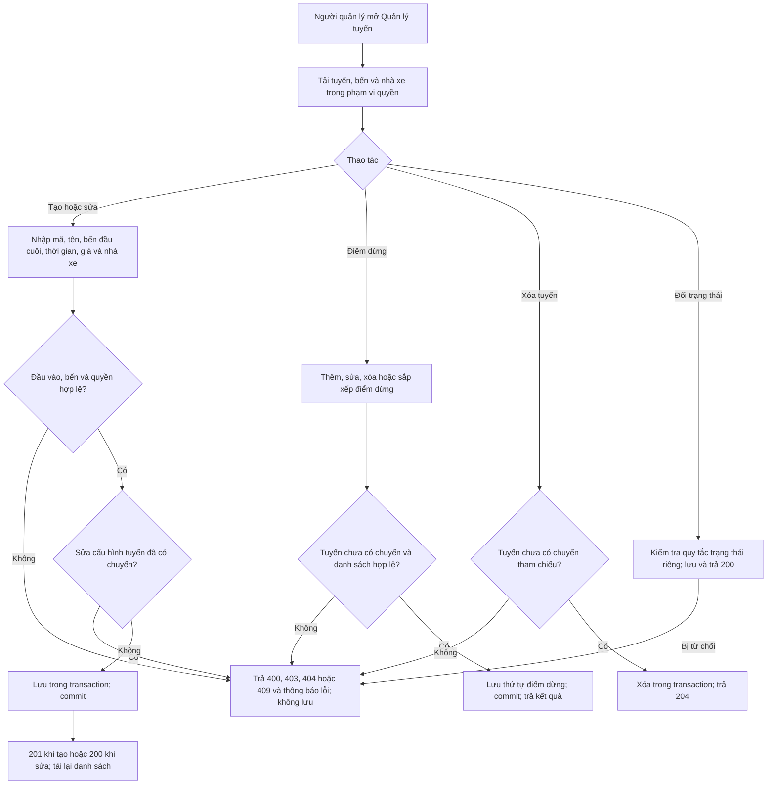
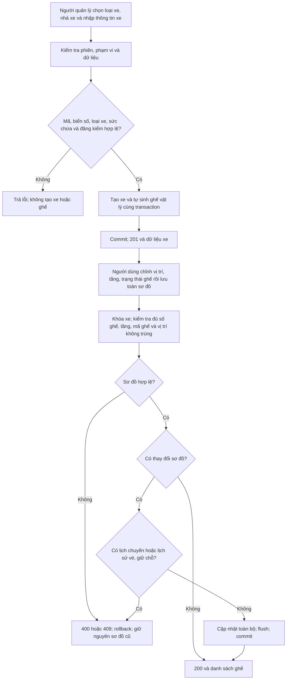
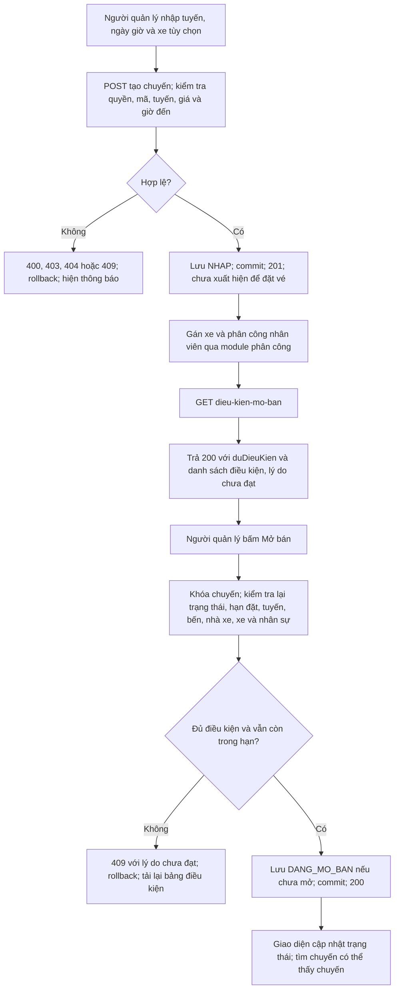
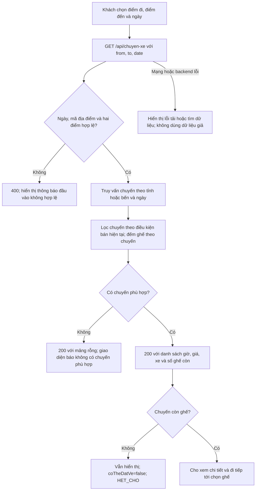
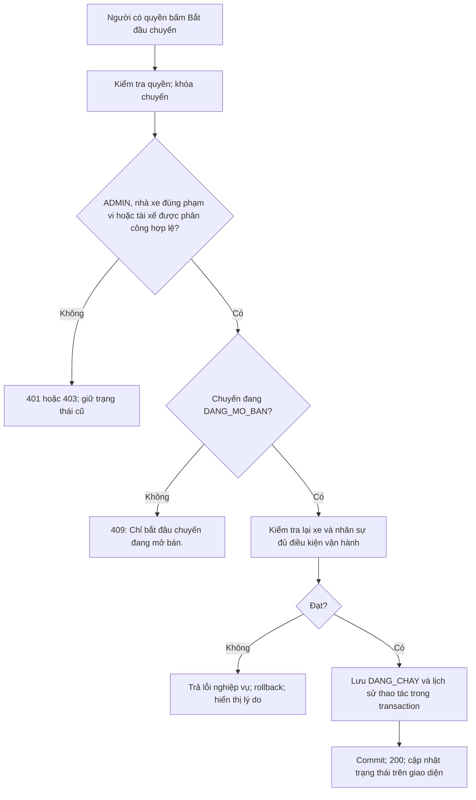
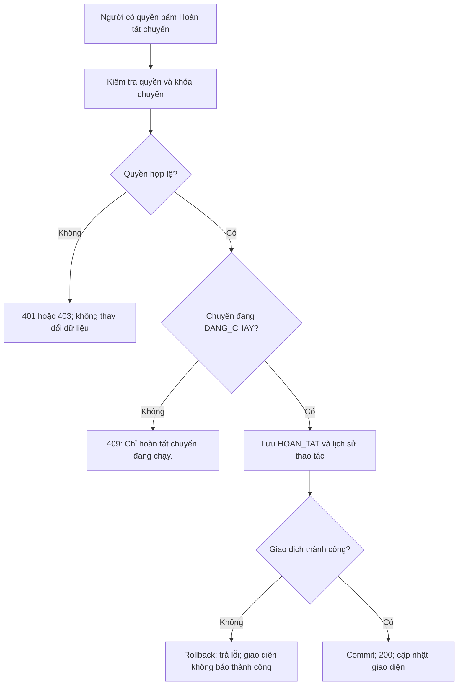
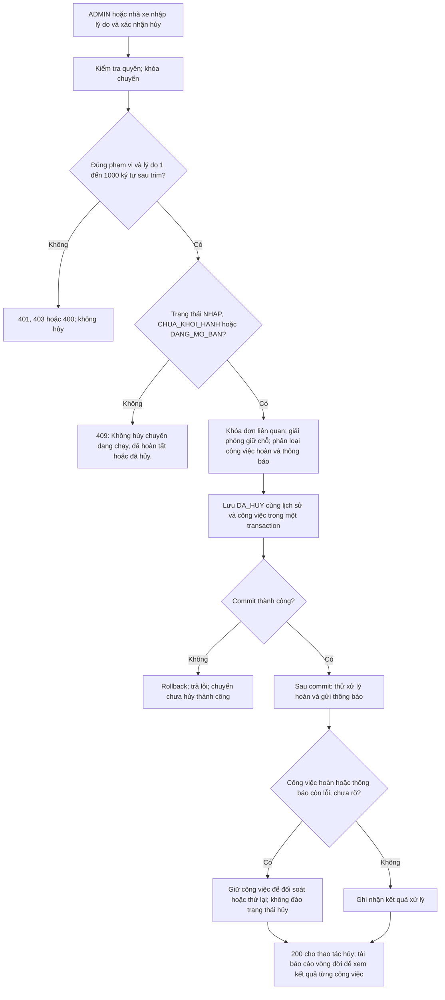

# Sơ đồ luồng nghiệp vụ — Lê Nguyễn Thanh Hiền

Đối chiếu nhánh `develop`, commit `0c2828b364366cd036e0a16ddc4a71a997f7cb16`.
Mở trên GitHub để xem sơ đồ Mermaid; trong VS Code cần trình xem Markdown hỗ trợ Mermaid.
[Bảng truy vết chức năng](bang-truy-vet-chuc-nang.md) dẫn tới Frontend, Controller, Service, dữ liệu và test của từng luồng.

## Quy ước chung

Các luồng ghi dữ liệu kiểm tra đăng nhập, quyền và CSRF tại tầng xác thực chung,
sau đó kiểm tra phạm vi tài nguyên ở Service. Lỗi xác thực/quyền trả 401/403;
CSRF sai hoặc thiếu bị từ chối theo bộ lọc chung. Không coi việc ẩn nút ở frontend là phân quyền.
Lỗi nghiệp vụ được trả qua `ApiErrors` với thông báo để giao diện hiển thị bằng `errorMessage`.
Các thông báo trong dấu ngoặc kép dưới đây được lấy từ code, là ví dụ đại diện,
không phải danh sách đầy đủ mọi lỗi. Lỗi trong transaction làm rollback; lỗi sau commit được xử lý theo từng luồng.

## 1. Quản lý tuyến và điểm dừng

Frontend: `RouteManagement.tsx`; Controller: `RouteTripController.handleRoutes`;
Service: `RouteTripService`. Endpoint gốc `/api/tuyen-xe`.

Ví dụ lỗi: 400 “Trạm khởi hành và trạm đến phải khác nhau”; 409
“Bến khởi hành và bến đến phải đang hoạt động để cấu hình tuyến”.
Đổi trạng thái là thao tác riêng; không suy ra tuyến đã có chuyến thì mọi thao tác đều bị cấm.
Kiểm thử: `RouteTripServiceTest.stationAndRouteValidationAndDeleteProtection`,
`routeAndStopsCannotBeChangedAfterTripsExistButStatusCanChange`,
`invalidStopOperationsDoNotChangeExistingOrder`.

## 2. Tạo xe và sơ đồ ghế

Frontend: `VehicleManagement.tsx`; Controller: `VehicleController`;
Service: `VehicleService`. Tạo xe dùng `POST /api/xe`, lưu sơ đồ dùng
`PUT /api/xe/{maXe}/so-do-ghe`.

Ví dụ lỗi: 409 “Biển số đã tồn tại.”; 400 “Sức chứa phải khớp với loại xe.”;
400 “Tầng ghế không hợp lệ.”; 409 “Xe đang có lịch chuyến; không sửa sơ đồ ghế.”.
Ghế vật lý hoạt động/bảo trì khác với tình trạng trống/giữ/đã bán của một chuyến.
Kiểm thử: `VehicleTask10Test.typeAndVehicleValidationUniquePlatesAndFilters`,
`layoutRejectsWrongCountsDuplicatesForeignIdsAndInvalidFloorsWithoutPartialSave`;
`PostgresTask10Test.concurrentSamePlateAcrossTypesCreatesOnlyOneCompleteVehicle`.

## 3. Tạo chuyến nháp và mở bán

Frontend: `TripManagement.tsx`; Controller: `TripController`;
Service: `TripService`, `TripSaleRules`, `VehicleRules`, `AssignmentRules`.
Endpoint gốc `/api/quan-ly/chuyen-xe`.

Tạo nháp cho phép thiếu xe và nhân sự; mở bán thì bắt buộc đủ điều kiện.
GET điều kiện không đạt vẫn có thể trả 200 với `duDieuKien=false`; POST mở bán thất bại trả 409.
Ví dụ lỗi: “Mã chuyến đã tồn tại.”; “Ngày giờ đến phải sau khởi hành.”;
“Chuyến chưa được gán xe.”; “Đã đến thời điểm ngừng nhận đặt vé trong khi kiểm tra điều kiện.”.
Mở bán lại trong hạn và đủ điều kiện không tạo chuyến mới. Hai chuyến xung đột lịch phải kiểm tra bằng khóa database.
Kiểm thử: `TripServiceTest.draftCanLackVehicleAndCrewButCannotBeSearchedOrSold`,
`actualT11AssignmentFlowAndIdempotentOpening`, `cutoffReachedDuringValidationStillRollsBackOpening`;
`PostgresTripTest.conflictingSimultaneousPublishSerializesUnderDatabaseLocks`.

## 4. Tìm chuyến

Frontend thuộc Nguyễn Thế An: `SearchForm.tsx`, `SearchResultsPage.tsx`, `booking/lib/api.ts`.
Backend của Hiền: `RouteTripController.handleTrips` → `RouteTripService.searchChuyenXe`
→ `ChuyenXeRepository.findForSearch` → `TripSaleRules.ensureSellable` → `searchView`.

Ví dụ lỗi: “Ngày đi là bắt buộc”; “Tỉnh đi và tỉnh đến phải khác nhau.”.
Chuyến không còn đủ điều kiện bán bị bỏ khỏi kết quả; không trả lỗi toàn bộ chỉ vì một chuyến không bán được.
Kết quả rỗng là thành công HTTP, khác lỗi API. Chọn ghế ở frontend chưa giữ ghế trong database.
Kiểm thử: `RouteTripServiceTest.emptySearchWrongDirectionDateAndDepartureOrdering`,
`searchAcceptsCityStationAndLegacyCodesWithoutChangingSaleRules`,
`publicDetailAndAvailabilityUseCurrentTripSpecificSeats`.

## 5. Bắt đầu chuyến

`POST /api/quan-ly/chuyen-xe/{maChuyen}/bat-dau` → `TripService.transition`.

Bấm bắt đầu lại khi đã chạy bị từ chối, không tạo thêm lịch sử thành công.
Kiểm thử: `TripServiceTest.lifecycleRejectsInvalidStatesAndDoesNotDuplicateHistory`,
`lifecycleRechecksVehicleAndRejectsCustomer`, `assignedDriverCanOperateButCannotCancelOrOperateAnotherTrip`.

## 6. Hoàn tất chuyến

`POST /api/quan-ly/chuyen-xe/{maChuyen}/hoan-thanh` → `TripService.transition`.

Hoàn tất chuyến không tự đánh dấu toàn bộ vé là đã lên xe.
Kiểm thử: `TripServiceTest.completingDoesNotMarkUninspectedPassengersAsBoarded`,
`lifecycleRejectsInvalidStatesAndDoesNotDuplicateHistory`.

## 7. Hủy chuyến và theo dõi xử lý

`POST /api/quan-ly/chuyen-xe/{maChuyen}/huy` với `{lyDo}` → `TripService.cancel/transition`.
Báo cáo: GET hậu tố `/vong-doi`; thử lại công việc: POST hậu tố `/xu-ly-hoan`.

Ví dụ lỗi: 400 “Vui lòng nhập lý do hủy chuyến.”; 400 “Lý do hủy không được vượt quá 1000 ký tự.”.
Tài xế được phân công có thể bắt đầu/hoàn tất nhưng không có quyền hủy.
Đơn chưa thu tiền không cần hoàn; đơn đã thu có thể chờ xử lý; giao dịch chưa rõ hoặc đơn chứa chuyến khác cần đối soát.
Cấu hình phê duyệt chính sách hoàn và khả năng của nhà cung cấp ảnh hưởng bước hoàn thực tế.
**Hủy thành công không đồng nghĩa đã hoàn tiền hoặc đã gửi email thành công.**
Kiểm thử: `TripServiceTest.cancellingReleasesHoldsWithoutAnOrderAndRequiresReason`,
`assignedDriverCanOperateButCannotCancelOrOperateAnotherTrip`, `lifecycleRejectsInvalidStatesAndDoesNotDuplicateHistory`.
Các test này không thay thế kiểm thử nhà cung cấp hoàn tiền/email thật.

## Cách dùng khi trình bày

Chọn một sơ đồ, đi từ thao tác người dùng tới endpoint, mở Controller rồi Service tương ứng,
chỉ ra một nhánh thành công và một nhánh thất bại, sau đó mở test dẫn ở cuối luồng.
Dùng bảng truy vết để chỉ đúng Entity/bảng và phân biệt JPA với native SQL.
Các test được dẫn là test hiện có trong source, chưa phải báo cáo chạy mới của lần bổ sung tài liệu này.
